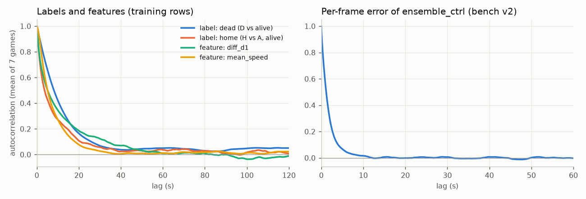
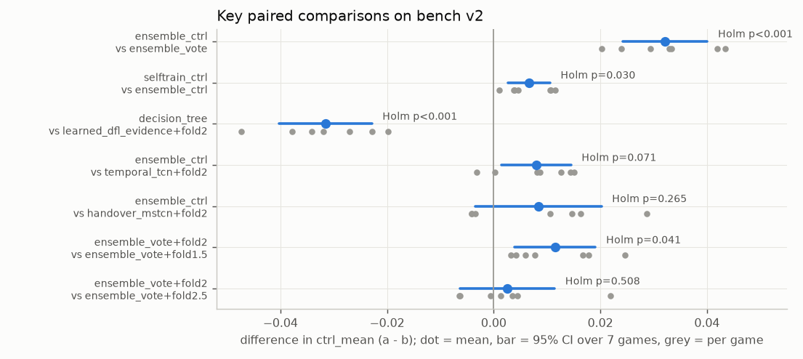
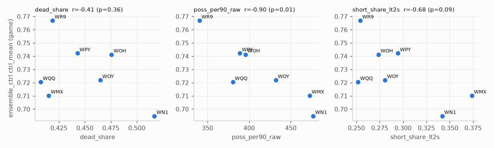
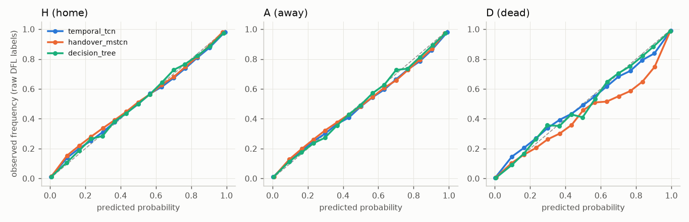
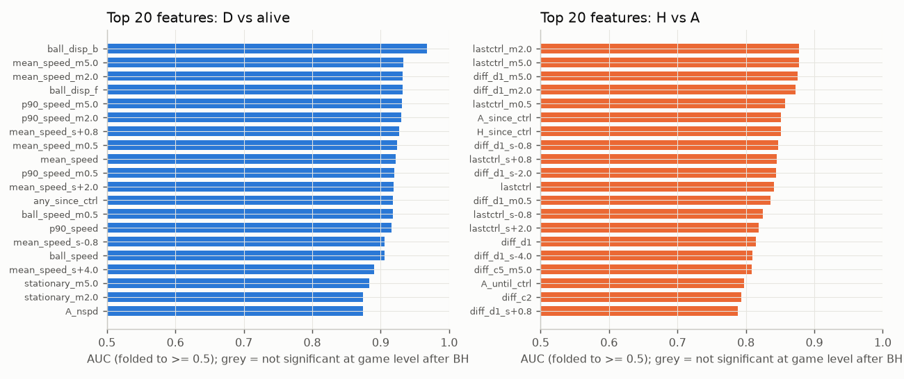
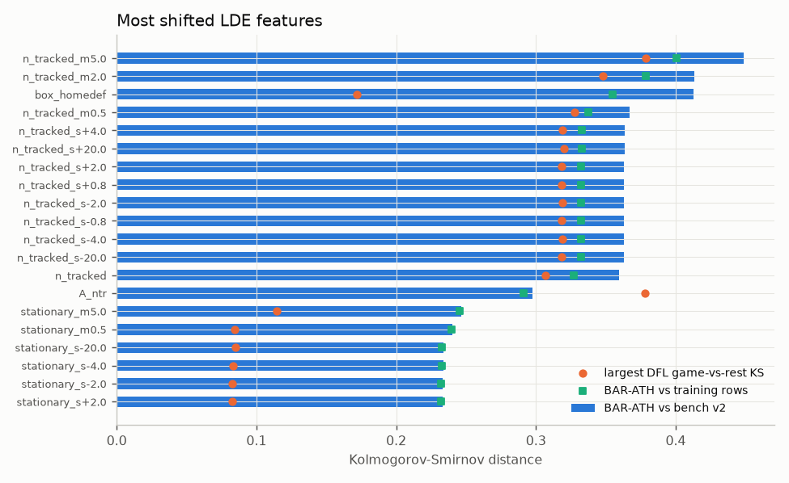
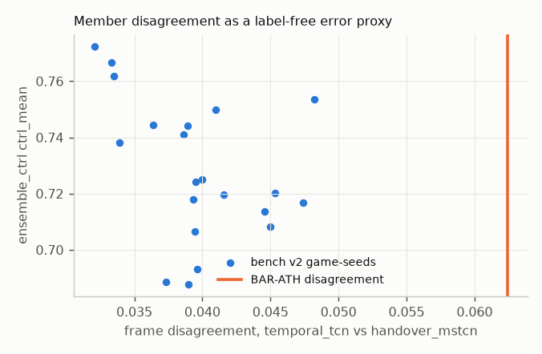
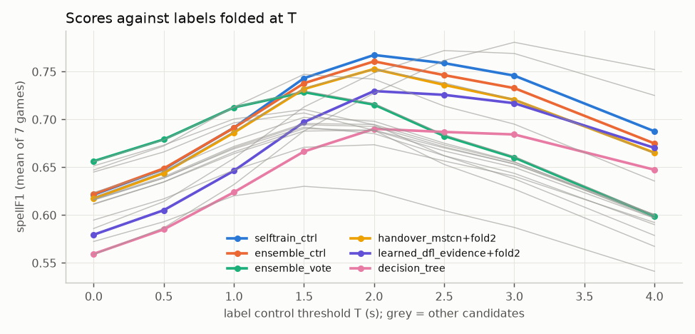
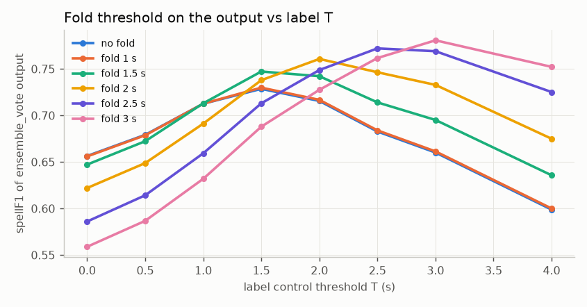

# Statistical review of the bench, the candidates and the features

Reviewed 2026-11-08 on branch `submission-v1`. Inputs: saved bench-v2 outputs
(`$MTAH_WORK/probs`), training rows (`$MTAH_WORK/ds_v2`), and the competition match's positions and
our own submission CSVs. No label of the competition match was read, and `evaluation/gt`,
`evaluation/reports` and `evaluation/run_evaluation.py` were not used. Scripts and figures are in
this folder; caches and full result tables are in `$MTAH_WORK/stats/`.

"Score" below means **ctrl_mean**: spellF1 against controlled-possession labels, averaged over
T = 1, 2, 3 s, on bench v2 (7 DFL games x 3 degradation seeds, leave-one-game-out models).
Unless stated otherwise, a CI is a 95% interval over the **7 games**.

## What this means for our decisions

1. **Ship `selftrain_ctrl` or `ensemble_ctrl`. Both are fine, and the gap between them is small
   and partly selection noise.** In-sample, `selftrain_ctrl` beats `ensemble_ctrl` by
   **+0.0066 [0.0027, 0.0105]**. It wins 7/7 games and 17/21 game-seeds, Holm-adjusted p = 0.030.
   That confirms the claimed +0.007. But its setting was picked from 52 variants on the same games.
   A nested leave-one-game-out selection gives **+0.0038 [-0.0006, +0.0083]** (p = 0.08), so about
   half of the gain is selection optimism. On one new match, the better of the two wins with
   probability about 0.7 to 0.8.
2. **The unknown control threshold T matters more than any model choice among the top
   candidates.** The output fold that scores best always sits next to the label T (fold 1.5 s is
   best at T = 1 to 1.5 s, 2.0 at 2 s, 3.0 at T >= 3 s). Choosing fold 2.0 s costs 0.034 if the
   truth is the raw every-touch flag (T = 0) and 0.048 if T = 3 s. The top models differ by at
   most 0.015. The ranking also flips: at T = 0, `ensemble_vote` (no fold) is best with
   P(rank 1) = 0.91. So the fold decision is a bet on what the organisers' "owning" means. The
   bench cannot settle it, and further model tuning will not move the result as much.
3. **Within ctrl_mean, fold 2.0 s cannot be told apart from 2.5 s.** The difference is
   +0.0026 [-0.006, +0.011], p = 0.51, and 2.0 wins on only 4 of 7 games. Fold 2.0 does beat
   1.5 s (+0.0115 [0.004, 0.019], Holm p = 0.04). Picking the fold on the same 7 games inflates
   the score by about 0.003 (nested estimate 0.7251 vs 0.7283 in-sample). 2.0 s is defensible as a
   minimax choice over T = 1 to 3 s (worst-case regret 0.048, against 0.054 for 2.5 s). It is not
   "the best".
4. **The ensemble buys little over one folded member.** `ensemble_ctrl` beats
   `handover_mstcn` + fold 2 s by **+0.008 [-0.003, +0.020]** (not resolved, 4/7 games). It beats
   `temporal_tcn` + fold by +0.008 [0.0015, 0.0145] (Holm p = 0.07). Most of the old gap
   between the ensemble and its members came from the fold, not from the vote.
5. **`decision_tree` is clearly worse than LDE with the same fold: -0.032 [-0.040, -0.023],
   0/7 games, Holm p = 0.0007.** Its README says the gap is 0.006. That is wrong (see
   "Contradictions"). Keep it as an interpretable exhibit, not as a contender.
6. **The competition match is easy to tell apart from every DFL bench game.** A classifier
   separates the two with AUC **0.986**. One DFL game against the other six gives 0.55 to 0.89.
   The separation comes from player tracking (number of tracked players, tracklet length, share
   of stationary players, team shape): dropping every ball feature leaves the AUC at 0.984. The
   control features the models rely on (`lastctrl`, `*_since_ctrl`, `diff_d1`) stay inside the
   DFL game-to-game range. The warning signs are elsewhere:
   - `stationary` (a strong dead-ball cue, AUC 0.86) is shifted 2 to 3 times beyond the DFL range.
   - The ball-movement cues (`ball_disp_b`, which carries 51% of the tree's splits, and
     `ball_speed`) are shifted 1.4 to 1.9 times beyond the DFL range in shape, though their means
     move by under 0.1 SD.
   - Team-shape features (`diff_spread_m5.0`, `H_length`) are shifted by +0.26 and +0.43 SD,
     probably Barcelona's style. The decision tree uses them for its H/A call.
   - The two strongest members disagree on 6.2% of the match's frames, against 3.2% to 4.8% on
     every bench game-seed.

   Expect the match score to be lower and noisier than bench v2 says.
7. **Benches: test at the game level and stop reading per-frame or per-seed p-values.** One game
   carries about 180 effective frames per label series (design effect 90 to 160 at 0.2 s rows).
   With 7 games, the 80%-power minimum detectable difference is **0.005 to 0.016**, depending on
   the pair. Exact non-parametric game-level tests bottom out at p = 1/64 = 0.0156, so after Holm
   they can never pass for a family of more than 3 comparisons. Use the paired t over game means,
   and say so when you do.
8. **Features: about a quarter of the 194 carry nothing.** 44 features are not significant for
   either task at the game level after FDR. 45 have AUC < 0.55 on both tasks and are unused by the
   tree: all the `n_tracked*` variants, the box, centroid, defensive-line and length features,
   and the 20 s shifts. The rest collapse into 133 clusters at |rho| >= 0.9. The unused
   `n_tracked*` and box features are also the most domain-shifted ones. Dropping them costs
   nothing on DFL and removes a channel through which the match's shift could reach the model.

## Contradictions with claims in the repo

| claim | where | what the data says |
|---|---|---|
| "ctrl_mean 0.666 is 0.006 below LDE with the same fold (0.672)", and "LDE gains about +0.056" from the fold | `decision_tree/README.md` | 0.672 is LDE **without** the fold. LDE + fold 2 s scores **0.698**. The tree is 0.032 below it (7/7 games). LDE gains +0.026 from the fold, not +0.056. |
| `selftrain_ctrl` +0.007 over `ensemble_ctrl` | workflow notes | Correct in-sample (+0.0066). Selection-corrected it is +0.0038, CI includes 0. |
| fold 2.0 s "was best" over T = 1 to 3 | `candidates/README.md` | Best by 0.0026 over 2.5 s, p = 0.51. It is the minimax choice, not a resolved best. |
| `degrade_v2` matches BAR-ATH's tracking | `candidates/README.md`, `degrade_v2.py` | Ball statistics match. Player tracklets do not: median 35.5 s on BAR-ATH vs 57.6 to 63.4 s on every bench game-seed (z = -13.6). The randomised training degradation (ds_v2) puts 3 to 11 times the match's jitter on the ball (0.028 to 0.103 m vs 0.009 m) and 6 to 25 times its median acceleration (37 to 141 vs 5.7 m/s²). |

The other claims I checked hold. Bench v2 reproduces ensemble_ctrl = ensemble_vote + fold 2.0
exactly. The ranking and the ctrl_mean values in the READMEs match my recomputation to 4
decimals. Paired differences are much tighter than per-candidate SEs. The ensemble's raw lead over
`handover_mstcn` is unresolved.

---

## 1. Dependence structure (`s02_dependence.py`)

**Method.** Integrated autocorrelation time tau (Sokal window), effective sample size
ESS = n / tau and design effect for a mean (= tau). These are computed on the training rows
(ds_v2, seed 41, one row per 0.2 s) for labels and key features, and at 25 fps for the per-frame
error of `ensemble_ctrl` on bench v2. I also computed the ICC of that error within true
possessions, and split each score into a game and a seed-within-game variance component
(one-way random-effects ANOVA).

| series (median of 7 games) | tau | ESS per game | design effect |
|---|---|---|---|
| label D vs alive | 31 s | 187 | 153 |
| label H vs A (alive) | 20 s | 174 | 94 |
| `lastctrl` / `ball_seen` / `mean_speed` | 40 / 33 / 17 s | 143 / 177 / 333 | 200 / 161 / 86 |
| error of `ensemble_ctrl` (25 fps) | 3.3 s | 1773 | 80 |
| same error, clustered by true possession | ICC 0.475 | 808 | 177 |



| quantity | SD between games | SD between seeds | game ICC |
|---|---|---|---|
| ctrl_mean `ensemble_ctrl` | 0.023 | 0.012 | 0.77 |
| diff `selftrain_ctrl` - `ensemble_ctrl` | 0.0004 | 0.0073 | 0.00 |
| diff `ensemble_ctrl` - `ensemble_vote` | 0.0074 | 0.0075 | 0.49 |
| diff `decision_tree` - LDE + fold | 0.0062 | 0.0122 | 0.21 |
| diff `ensemble_vote` - `handover_mstcn` | 0.016 | 0.011 | 0.68 |

**Interpretation.**
- A 90-minute game holds about 140k frames but only about 180 independent pieces of evidence per
  label. A per-frame test overstates the sample by two orders of magnitude.
- Levels are dominated by the game: some games are simply harder. That is why per-candidate SEs
  (about 0.009) are useless for comparisons and paired differences are essential.
- For differences the game share varies a lot. For `selftrain` vs `ensemble_ctrl` it is zero:
  that gap is pure degradation-seed noise, so more seeds would sharpen it. For
  `ensemble_vote` vs `handover_mstcn` it is 0.68: more seeds will not help there, only more
  games will.

## 2. Model comparison (`s03_compare.py`, `s03b_selection.py`)

**Method.** Each comparison is paired on game and seed. Seeds are averaged within a game, and the
7 game means are the units. For each pair I report:
- the paired t (df 6), with a CI and dz = mean / SD;
- the exact Wilcoxon signed-rank test and the exact sign-flip permutation test (128 sign
  patterns);
- a game-cluster bootstrap CI;
- a REML mixed model `diff ~ 1 + (1 | game)`, with an LRT for the game variance;
- the naive t over the 21 game-seeds, only to show how it misleads;
- the 80%-power minimum detectable difference (MDD).

Holm is applied within the 7 key comparisons and within "every candidate vs the best".

| a vs b | diff [95% CI] | dz | p (t) | Holm p (t) | p (perm.) | games won | MDD80 |
|---|---|---|---|---|---|---|---|
| ensemble_ctrl vs ensemble_vote | **+0.032** [0.024, 0.040] | 3.8 | 0.0001 | 0.0004 | 0.016 | 7/7 | 0.011 |
| selftrain_ctrl vs ensemble_ctrl | **+0.0066** [0.0027, 0.0105] | 1.6 | 0.006 | 0.030 | 0.016 | 7/7 | 0.005 |
| decision_tree vs LDE + fold 2 | **-0.032** [-0.040, -0.023] | -3.4 | 0.0001 | 0.0007 | 0.016 | 0/7 | 0.012 |
| ensemble_ctrl vs temporal_tcn + fold 2 | +0.008 [0.0015, 0.0145] | 1.1 | 0.024 | 0.071 | 0.047 | 6/7 | 0.009 |
| ensemble_ctrl vs handover_mstcn + fold 2 | +0.008 [-0.003, 0.020] | 0.7 | 0.13 | 0.26 | 0.14 | 4/7 | 0.016 |
| fold 2.0 vs fold 1.5 (on ensemble_vote) | +0.0115 [0.004, 0.019] | 1.4 | 0.010 | 0.041 | 0.016 | 7/7 | 0.010 |
| fold 2.0 vs fold 2.5 (on ensemble_vote) | +0.0026 [-0.006, 0.011] | 0.3 | 0.51 | 0.51 | 0.66 | 4/7 | 0.012 |



**Selection-corrected self-training gain.** The offline grid has 13 saved self-trained
probability sets x 4 soft weights = 52 variants. Rebuilding it shows:
- 88% of the variants beat `ensemble_ctrl` in-sample, by up to +0.0069. The shipped variant
  ranks 8th (+0.0066).
- Picking the best variant on 6 games and scoring it on the 7th gives **+0.0038
  [-0.0006, +0.0083]**, p = 0.08, 5/7 games.

The procedure helps, but the honest expected gain is about +0.004, not +0.007.

**Is a mixed model appropriate?** The design is balanced (3 seeds in every game), so the REML
fixed-effect estimate equals the game-level mean, and its test is close to the game-level t. The
game variance is clearly non-zero for `ensemble_ctrl` vs `ensemble_vote` (LRT p = 0.03) and for
vs `handover_mstcn` + fold (p = 0.03). For those, the game must be the unit. For
`selftrain` vs `ensemble_ctrl` the game variance is estimated at 0 (LRT p = 1), and the
mixed-model p (< 0.0001) is then essentially the naive 21-unit test. With only 7 groups that
variance estimate is fragile, so I rely on the game-level t and treat the mixed model as a
sensitivity check.

**Every candidate vs the best.** These are 21 comparisons each against `selftrain_ctrl` and
`ensemble_ctrl` (`$MTAH_WORK/stats/compare_all.csv`):
- Against `selftrain_ctrl`, every other candidate is significantly worse after Holm (t-based),
  including `ensemble_ctrl` (Holm p = 0.018), except `ensemble_vote` + fold 2.5 (+0.009,
  Holm p = 0.07).
- Against `ensemble_ctrl`, `ensemble_vote` + fold 2.5 and both folded single members are not
  separated after Holm.
- No exact permutation test survives Holm in a 21-test family: the smallest possible adjusted
  value is 21/64 = 0.33. This is a limit of having 7 games, not evidence of no effect.

**Single-match outlook.** Using the game-seed spread of each difference, the probability that
the better model also wins on one new game is about:

| pair | P(better model wins one game) |
|---|---|
| `selftrain` vs `ensemble_ctrl` | 0.81 (0.7 after selection correction) |
| `ensemble_ctrl` vs `handover_mstcn` + fold | 0.71 |
| fold 2.0 vs 2.5 | 0.57 |
| `ensemble_ctrl` vs `ensemble_vote` | 1.00 |

The spread of `ensemble_ctrl` itself across game-seeds is SD 0.025 (0.688 to 0.772). One match is
a noisy draw.

## 3. Heteroskedasticity, residuals, calibration, influence (`s04_residuals.py`)

### Score vs game characteristics

**Method.** Dead share, ball-missing share, possessions per 90, mean spell length, share of spells
under 2 s and home share are fixed per game, so n = 7. I report game-level Pearson and Spearman
correlations with BH over the 30 tests. Brown-Forsythe tests whether the seed noise differs
between games. Breusch-Pagan is run on the 21-row OLS of score on dead share and ball-missing
share (game-clustered SEs).

**Results.**
- Score tracks match tempo: r = **-0.90** with possessions per 90 (p = 0.006) and +0.82 with mean
  spell length (p = 0.02). After BH over 30 tests, q = 0.19, so treat this as a strong pattern,
  not a confirmed law.
- Games with many short spells are harder. The fold gains less where the ball is missing more
  (r = -0.76, p = 0.045 unadjusted).
- Brown-Forsythe p = 0.57 to 0.99 and Breusch-Pagan p = 0.65: no evidence that seed noise differs
  between games. With 3 seeds per game these tests have almost no power.
- Within a game, seeds that hide more of the ball score lower: -0.45 per unit of ball-missing
  share, p = 0.04 with 7 clusters, so fragile.



**Interpretation.** Most of the game-to-game variation in score is explained by how often
possession changes. If BAR-ATH has many short possessions, expect the low end of the bench range.

**Skipped:** a multiple regression on 4+ game characteristics (7 points, not estimable) and the
White test (too many square and cross terms for 21 rows with 7 distinct predictor values).

### Per-frame logistic models

**Method.** Training rows (ds_v2 seed 41; 145k rows for dead vs alive, 106k alive rows for H vs A)
were fitted with standardised top features. I compared SEs under three assumptions: iid,
clustered by possession spell, and clustered by game (CR1, t(6) reference).

| model | SE inflation vs naive: spell clusters | game clusters | terms "significant" naively but not by game |
|---|---|---|---|
| dead vs alive | 3.6 to 5.4x | 3.1 to 13.9x | `stationary_m2.0` (naive z = 6.7, game p = 0.19) |
| H vs A | 3.6 to 5.7x | 5.6 to 22.7x | `diff_cx_m2.0` (z = 8.8, p = 0.30), `diff_fwd_m2.0` (z = 47, p = 0.08), `diff_c5_m0.5` |

**Residuals.**
- Durbin-Watson on within-game Pearson residuals is 0.15 to 0.65 (one exception: 1.7 for the
  dead-ball model on WPY); 2 would mean independence. Lag-1 residual correlation is 0.68 to 0.92
  (0.15 on WPY), and Ljung-Box p is about 0 in every game.
- Residual correlation is gone by about 5 s (lag-25 r <= 0.10).
- Leave-one-game-out influence: no single game moves any coefficient by more than 1.15
  game-clustered SEs. WR9 is the most influential for the H/A shape terms, WQQ for dead ball.

**Interpretation.** Under realistic SEs the dead-ball model rests on the ball being visible or
moving, player speed, ball out of play and time since last control. The team call rests on
`lastctrl` and the nearest-player distance gap. Team-shape terms are not reliably different
from 0 across games, which is also why they are the risky ones under domain shift (section 5).

### Calibration on bench v2

**Method.** Every 5th frame, scored against raw DFL labels (what the members were trained on),
with a game-cluster bootstrap. `ensemble_vote` saves vote shares (4 levels), not probabilities,
so it was skipped.

| candidate | ECE H / A / D | Brier (sum over classes) |
|---|---|---|
| temporal_tcn | 0.011 / 0.011 / 0.007 | 0.107 |
| handover_mstcn | 0.009 / 0.008 / 0.008 | 0.109 |
| ball_radar | 0.010 / 0.010 / 0.009 | 0.109 |
| decision_tree | 0.008 / 0.007 / 0.005 | 0.128 |
| pitch_control, skillcorner_domain, ballfree_dead, semimarkov_lattice | 0.015 to 0.020 | 0.121 to 0.125 |
| pathcrf_dynamic | **0.049 / 0.050 / 0.030** (overconfident) | 0.131 |



**Interpretation.** The shipped members are well calibrated: ECE about 0.01, with the game
bootstrap CI upper bound at most 0.016. So adding their probabilities (as `selftrain_ctrl`'s soft
vote does) is sound. Recalibrate `pathcrf_dynamic` before it is used in any soft combination.

## 4. Features (`s05_features.py`)

**Method.**
- **Data.** ds_v2 seed 41, all stride-5 rows, 7 games.
- **Effect sizes.** For each feature and task (D vs alive; H vs A on alive rows), the pooled AUC
  and standardised mean difference, and the same per game.
- **Significance.** Game-level p = one-sample t of the 7 per-game SMDs, then BH over 388 tests.
- **Redundancy.** Spearman correlation clusters on 30k rows, VIF, and impurity importance from
  the shipped tree.

**Results.**

| | D vs alive | H vs A |
|---|---|---|
| significant at q < 0.05, game level | 111 / 194 | 61 / 194 |
| "significant" with naive per-frame tests | 177 / 194 | 169 / 194 |
| AUC >= 0.6 (or <= 0.4) | 92 | 60 |
| best features | `ball_disp_b` (AUC 0.97, its NaN-ness alone: 70% of dead rows vs 7% of alive), `mean_speed_m5.0`, `p90_speed_m5.0`, `any_since_ctrl` (0.92) | `lastctrl_m2.0` (0.88), `diff_d1_m5.0` (0.88), `A_/H_since_ctrl` (0.85) |

Every top-15 feature has the same sign in 7/7 games, and the worst-game AUC is still >= 0.76.
As a check, the H/A-symmetric ("sym") features carry no team information (max |AUC - 0.5| = 0.04).



**Redundancy.**
- 194 features collapse to 133 clusters at |rho| >= 0.9, and 156 at 0.95.
- 116 features have VIF > 10, and 36 have VIF > 1000. The `diff_x = H_x - A_x` columns are exact
  linear combinations, so their VIF is effectively infinite.
- The large clusters are the multi-scale copies of one signal: 10 speed variants, 8 `ball_seen` /
  gap variants, 6 `lastctrl` variants, 6 `n_tracked` variants, and 10 centroid / defensive-line
  variants.
- The tree puts 51% of its importance on `ball_disp_b`, 23% on `lastctrl` and 7% on
  `any_since_ctrl`.

**Redundant or useless (45 features).** These have AUC < 0.55 on both tasks and less than 0.1%
tree importance (list in `$MTAH_WORK/stats/feature_clusters.csv`). They include all 13 `n_tracked*`
features, `box_homedef` and `box_awaydef`, `near_corner`, `H_/A_cx`, `_length`, `_defline`,
`_final3` and `_ntr`, `diff_cx*`, and most of the `*_pmf` and `*_s±20.0` features.

**Interpretation.**
- Trees and boosting are unaffected by collinearity. Any linear or logistic model (including a
  stacker) must use one representative per cluster, or regularise.
- Pruning the 45 dead features is free on DFL and removes the most shifted inputs (next section).
- Naive per-frame tests would call almost every feature "significant". Use the game-level
  numbers.

## 5. Domain shift: competition match vs DFL (`s06_shift.py`)

**Method.**
- **Data.** LDE features on the match (positions only, every 5th graded frame, 31.8k rows) vs
  bench v2 (seed 2027, 200k rows) vs training rows (200k).
- **Distance and yardstick.** KS distance per feature, compared with each DFL game against the
  other six, which shows how big an ordinary game-to-game difference is.
- **p-values.** Autocorrelation handled by thinning to one row per 30 s before the KS and
  Anderson-Darling tests (BH over features).
- **Classifier two-sample test.** HistGradientBoosting, 5-fold grouped CV on 5-minute chunks.
- **Tracking statistics.** `match_stats` label-free statistics against all 21 bench and training
  game-seeds.
- **Output check.** Label-free statistics of our own predictions on the match vs on the bench, and
  member disagreement as an error proxy.

**Results.**

| classifier two-sample test, AUC | all features | without ball features |
|---|---|---|
| BAR-ATH vs bench v2 | **0.986** | **0.984** |
| one DFL game vs the other six | 0.55 to 0.89 (median 0.68) | 0.59 to 0.89 |

- **Features.**
  - 52/194 features shift beyond the largest DFL game-vs-rest KS, and 37 stay significant after
    thinning and BH.
  - The most shifted: `n_tracked*` (KS 0.36 to 0.45; unused by the models), `box_homedef`
    (0.41 vs DFL max 0.17), `stationary*` (0.23 to 0.25 vs DFL max 0.08 to 0.12; the match has
    25.3% stationary players vs 21.1%), `H_length` (+0.43 SD) and `diff_spread_m5.0` (+0.26 SD).
- **Features the models use.** `lastctrl`, `H_/A_since_ctrl`, `diff_d1_m2.0` and `H_/A_width` are
  inside the DFL range (KS ratio 0.2 to 0.9). `ball_disp_b`, the tree's main split, is beyond the
  range in KS (0.15 vs 0.09) but by only +0.08 SD, with q = 0.10 after thinning. Of the 30 most
  discriminative features, 10 are shifted beyond the DFL range. All 10 are dead-ball cues: the
  ball-movement features (`ball_disp_b/f`, `ball_speed*`; KS ratio 1.4 to 1.9, mean shift
  < 0.1 SD) and the `stationary` variants (ratio 2.2 to 2.8).
- **Tracking statistics.**
  - Ball-gap statistics fit (z within ±1.7), except that BAR-ATH keeps even more of its missing
    ball in long gaps (0.997 vs 0.964 to 0.986).
  - Player tracklets are much shorter: median 35.5 s vs 57.6 to 63.4 s on bench v2. The bench
    under-fragments players.
  - The randomised training degradation puts 3 to 11 times more jitter on the ball than the match
    has.
- **Our predictions on the match.**
  - Dead share is 0.470, inside the bench range of 0.42 to 0.54.
  - Possessions per 90: `ensemble_ctrl` predicts 246 (bench prediction 259; truth T = 2: 272),
    `selftrain_ctrl` 226 (bench 253). The ratio of match to bench is similar for both, so there
    is no sign that self-training behaves differently on the match.
  - `temporal_tcn` and `handover_mstcn` disagree on **6.2%** of graded frames on the match, against
    **3.2% to 4.8%** on all 21 bench game-seeds. On the bench, more disagreement goes with a lower
    score, though weakly (game-level r = -0.53, p = 0.22). Extrapolating gives ctrl_mean about
    0.68 [0.60, 0.76] on the match. That is outside the data range, so treat it as a warning,
    not an estimate.




**Interpretation.**
- The ball side of degrade_v2 is well matched. The player side is not: tracking structure, the
  share of stationary players, and team shape.
- The models' main evidence (control proximity, last control, ball movement) is mostly robust.
  But the dead-ball cues from player speed and stationarity, and the team-shape features, are
  exposed.
- The members' extra disagreement on the match is the best label-free evidence that this matters.
- Cheap mitigations:
  1. Set degrade_v2's tracklet length nearer 35 s.
  2. Cap the training ball noise near the match's.
  3. Drop the unused shifted features (`n_tracked*`, box counts).
  4. Check whether the H/A call leans on team shape (`diff_spread`, `H_/A_length`, `H_/A_width`),
     because those are where Barcelona's style differs from the Bundesliga games.

## 6. Control threshold T (`s07_threshold.py`)

**Method.**
- Scores against labels folded at T = 0, 0.5, 1, 1.5, 2, 2.5, 3 and 4 s.
- Kendall's tau of each T's ranking against the ctrl_mean ranking, and the game-bootstrap
  probability of ranking first.
- `ensemble_vote` + fold t (t = 1 to 3 s) at every label T, with paired tests of 2.0 vs 1.5 and
  2.5 per T.
- A nested leave-one-game-out choice of t.

| label T | best output fold | regret of fold 2.0 | fold 2.0 vs 1.5 | fold 2.0 vs 2.5 | best candidate (P rank 1) |
|---|---|---|---|---|---|
| 0 (raw DFL) | none | 0.034 | -0.025 (p < 0.001) | +0.036 | ensemble_vote (0.91) |
| 1 | 1.5 | 0.022 | -0.022 (p < 0.001) | +0.032 | ensemble_vote + fold 1.5 (0.57) |
| 1.5 | 1.5 | 0.009 | -0.009 (p = 0.02) | +0.025 | |
| 2 | 2.0 | 0 | +0.019 (p = 0.005) | +0.012 (p = 0.04) | selftrain_ctrl (0.99) |
| 2.5 | 2.5 | 0.026 | +0.032 | -0.026 (p = 0.004) | |
| 3 | 3.0 | 0.048 | +0.038 | -0.036 (p = 0.002) | ensemble_vote + fold 3 (1.0) |
| 4 | 3.0 | 0.077 | +0.039 | -0.050 | ensemble_vote + fold 3 (1.0) |

Kendall tau of each T's ranking against the ctrl_mean ranking: 0.33 at T = 0, 0.45 at T = 1,
0.91 at T = 2, 0.74 at T = 3.




**Interpretation.**
- At any single label T, the fold threshold is very well identified: the best fold sits next to
  T, and neighbours differ significantly.
- Averaged over T = 1 to 3 (ctrl_mean), 2.0 and 2.5 are statistically the same, and the nested
  choice lands on one or the other.
- The ranking of candidates is stable only between T = 1.5 and 3. Raw labels (T = 0) reverse the
  verdict on folding entirely.
- The 7 DFL games cannot tell us T. Only the definition and the organisers' ground truth can.
  CHALLENGE.md's "17 possessions in 5 minutes" equals about 306 per 90, between T = 1 (344) and
  T = 2 (272). A Poisson count of 17 has a 95% range of about 10 to 27 (180 to 490 per 90), so it
  is consistent with every T from 0 to 3 and should not be used to choose one.

## Caveats

- **7 games is the sample.** Every CI above is over 7 units with df = 6. Normality of 7 game means
  cannot be checked: Shapiro-Wilk on 7 values has no power, so it was skipped. The exact tests are
  reported alongside.
- **Bench v2 is itself a model.** All conclusions are about degraded DFL. Section 5 shows that the
  match differs from it in player tracking.
- **In-sample choices.** CONTROL_S = 2.0, the ensemble member set, and selftrain's setting were all
  chosen on these same 7 games. The nested estimates (+0.0038 for self-training; -0.003 for the
  fold choice) are the honest ones.
- **Missing outputs.** `ball_radar` and `semimarkov_lattice` saved probabilities but no codes, so
  they have no ctrl scores and are excluded from the ctrl comparisons. `selftrain_ctrl`'s live
  bench saved codes for one game only. Its 21 game-seeds were rebuilt from the offline harness
  (`s00`); they agree with the 3 live files on 99.998% of frames, with identical scores.
- **Subsampling.** Training-row analyses use seed 41 only; seeds 42 and 43 have the same labels
  and differ only in degradation. Calibration uses every 5th frame. Feature correlations use 30k
  random rows. Shift tests use every 5th graded frame, thinned to one row per 30 s for p-values.

## Reproduce

All scripts run from this folder with `OMP_NUM_THREADS=2` and the work venv
(`requirements.txt`; s00 and s03b also need the repo's lightgbm stack). Total runtime is about
12 minutes, of which s06 takes 8. Outputs go to `$MTAH_WORK/stats/` and `fig/`.

```
python s00_selftrain_codes.py   # rebuild selftrain_ctrl codes (21 game-seeds)
python s01_scores.py            # per game-seed scores x candidates x T  -> scores.csv, games.csv
python s02_dependence.py        # analysis 1
python s03_compare.py           # analysis 2
python s03b_selection.py        # analysis 2, selection-corrected self-training gain
python s04_residuals.py         # analysis 3
python s05_features.py          # analysis 4
python s06_shift.py             # analysis 5 (needs s05 output)
python s07_threshold.py         # analysis 6
```
